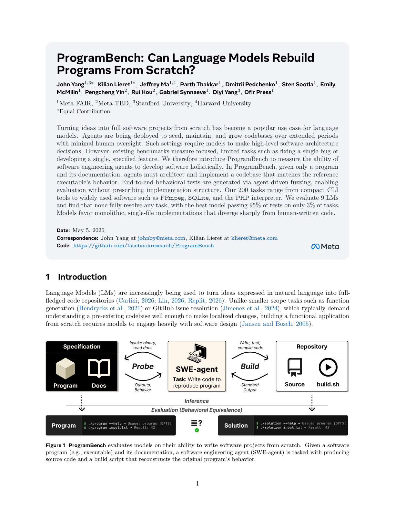

<!-- page: 1 -->

## Page 1

ProgramBench: Can Language Models Rebuild
Programs From Scratch?
John Yang1,3∗, Kilian Lieret1∗, Jeffrey Ma1,4, Parth Thakkar1, Dmitrii Pedchenko1, Sten Sootla1, Emily
McMilin1, Pengcheng Yin2, Rui Hou2, Gabriel Synnaeve1, Diyi Yang3, Ofir Press1
1Meta FAIR, 2Meta TBD, 3Stanford University, 4Harvard University
∗Equal Contribution
Turning ideas into full software projects from scratch has become a popular use case for language
models. Agents are being deployed to seed, maintain, and grow codebases over extended periods
with minimal human oversight. Such settings require models to make high-level software architecture
decisions. However, existing benchmarks measure focused, limited tasks such as fixing a single bug or
developing a single, specified feature. We therefore introduce ProgramBench to measure the ability of
software engineering agents to develop software holisitically. In ProgramBench, given only a program
and its documentation, agents must architect and implement a codebase that matches the reference
executable’s behavior. End-to-end behavioral tests are generated via agent-driven fuzzing, enabling
evaluation without prescribing implementation structure. Our 200 tasks range from compact CLI
tools to widely used software such as FFmpeg, SQLite, and the PHP interpreter. We evaluate 9 LMs
and find that none fully resolve any task, with the best model passing 95% of tests on only 3% of tasks.
Models favor monolithic, single-file implementations that diverge sharply from human-written code.
Date: May 5, 2026
Correspondence: John Yang at johnby@meta.com, Kilian Lieret at klieret@meta.com
Code: https://github.com/facebookresearch/ProgramBench
1
Introduction
Language Models (LMs) are increasingly being used to turn ideas expressed in natural language into full-
fledged code repositories (Carlini, 2026; Lin, 2026; Replit, 2026). Unlike smaller scope tasks such as function
generation (Hendrycks et al., 2021) or GitHub issue resolution (Jimenez et al., 2024), which typically demand
understanding a pre-existing codebase well enough to make localized changes, building a functional application
from scratch requires models to engage heavily with software design (Jansen and Bosch, 2005).
Invoke binary,
read docs
Write, test,
 compile code
Specification
Repository
Probe
Build
SWE-agent
Task: Write code to
reproduce program
Source
build.sh
Program
Docs
Outputs,
Behavior
Standard
Output
Inference
Evaluation (Behavioral Equivalence)
?
$ ./solution --help → Usage: program [OPTS]
$ ./solution input.txt → Result: 42
$ ./program --help → Usage: program [OPTS]
$ ./program input.txt → Result: 42
Program
Solution
Figure 1 ProgramBench evaluates models on their ability to write software projects from scratch. Given a software
program (e.g., executable) and its documentation, a software engineering agent (SWE-agent) is tasked with producing
source code and a build script that reconstructs the original program’s behavior.
1

### Assets

Caption: Figure 1 ProgramBench evaluates models on their ability to write software projects from scratch. Given a software

Caption: Figure 1 ProgramBench evaluates models on their ability to write software projects from scratch. Given a software

Caption: Figure 1 ProgramBench evaluates models on their ability to write software projects from scratch. Given a software

Caption: Figure 1 ProgramBench evaluates models on their ability to write software projects from scratch. Given a software

