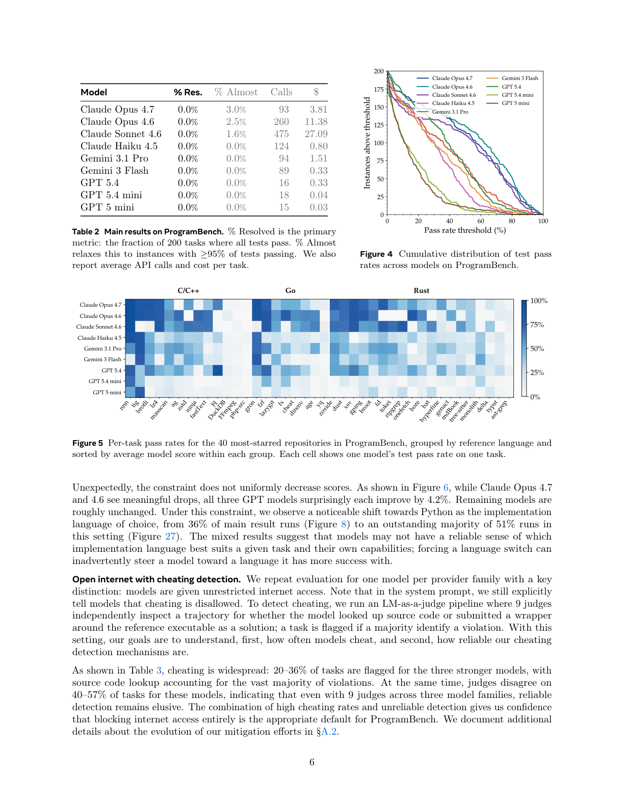

<!-- page: 6 -->

## Page 6

Model
% Res.
% Almost
Calls
$
Claude Opus 4.7
0.0%
3.0%
93
3.81
Claude Opus 4.6
0.0%
2.5%
260
11.38
Claude Sonnet 4.6
0.0%
1.6%
475
27.09
Claude Haiku 4.5
0.0%
0.0%
124
0.80
Gemini 3.1 Pro
0.0%
0.0%
94
1.51
Gemini 3 Flash
0.0%
0.0%
89
0.33
GPT 5.4
0.0%
0.0%
16
0.33
GPT 5.4 mini
0.0%
0.0%
18
0.04
GPT 5 mini
0.0%
0.0%
15
0.03
Table 2 Main results on ProgramBench. % Resolved is the primary
metric: the fraction of 200 tasks where all tests pass. % Almost
relaxes this to instances with ≥95% of tests passing. We also
report average API calls and cost per task.
0
20
40
60
80
100
Pass rate threshold (%)
0
25
50
75
100
125
150
175
200
Instances above threshold
Claude Opus 4.7
Claude Opus 4.6
Claude Sonnet 4.6
Claude Haiku 4.5
Gemini 3.1 Pro
Gemini 3 Flash
GPT 5.4
GPT 5.4 mini
GPT 5 mini
Figure 4 Cumulative distribution of test pass
rates across models on ProgramBench.
nnn
tig
brotli
lz4
masscan
ag
zstd
ninja
fastText
jq
DuckDB
FFmpeg
php-src
gron
fzf
lazygit
fx
cheat
direnv
age
yq
zoxide
dust
xsv
gping
broot
fd
tokei
ripgrep
onefetch
bore
bat
hyperfine
genact
mdBook
tree-sitter
monolith
delta
typst
ast-grep
Claude Opus 4.7
Claude Opus 4.6
Claude Sonnet 4.6
Claude Haiku 4.5
Gemini 3.1 Pro
Gemini 3 Flash
GPT 5.4
GPT 5.4 mini
GPT 5 mini
C/C++
Go
Rust
0%
25%
50%
75%
100%
Figure 5 Per-task pass rates for the 40 most-starred repositories in ProgramBench, grouped by reference language and
sorted by average model score within each group. Each cell shows one model’s test pass rate on one task.
Unexpectedly, the constraint does not uniformly decrease scores. As shown in Figure 6, while Claude Opus 4.7
and 4.6 see meaningful drops, all three GPT models surprisingly each improve by 4.2%. Remaining models are
roughly unchanged. Under this constraint, we observe a noticeable shift towards Python as the implementation
language of choice, from 36% of main result runs (Figure 8) to an outstanding majority of 51% runs in
this setting (Figure 27). The mixed results suggest that models may not have a reliable sense of which
implementation language best suits a given task and their own capabilities; forcing a language switch can
inadvertently steer a model toward a language it has more success with.
Open internet with cheating detection. We repeat evaluation for one model per provider family with a key
distinction: models are given unrestricted internet access. Note that in the system prompt, we still explicitly
tell models that cheating is disallowed. To detect cheating, we run an LM-as-a-judge pipeline where 9 judges
independently inspect a trajectory for whether the model looked up source code or submitted a wrapper
around the reference executable as a solution; a task is flagged if a majority identify a violation. With this
setting, our goals are to understand, first, how often models cheat, and second, how reliable our cheating
detection mechanisms are.
As shown in Table 3, cheating is widespread: 20–36% of tasks are flagged for the three stronger models, with
source code lookup accounting for the vast majority of violations. At the same time, judges disagree on
40–57% of tasks for these models, indicating that even with 9 judges across three model families, reliable
detection remains elusive. The combination of high cheating rates and unreliable detection gives us confidence
that blocking internet access entirely is the appropriate default for ProgramBench. We document additional
details about the evolution of our mitigation efforts in §A.2.
6

### Assets

Caption: Table 2 Main results on ProgramBench. % Resolved is the primary

Caption: Figure 4 Cumulative distribution of test pass

