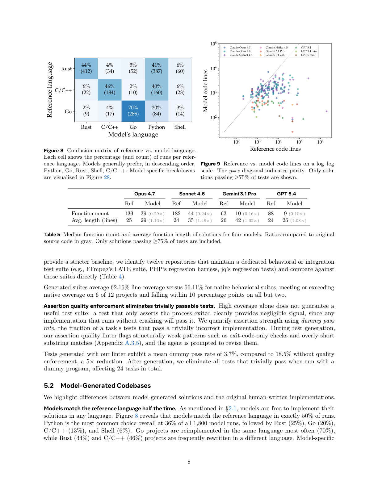

<!-- page: 8 -->

## Page 8

Rust
C/C++
Go
Python
Shell
Model's language
Rust
C/C++
Go
Reference language
44%
(412)
4%
(34)
5%
(52)
41%
(387)
6%
(60)
6%
(22)
46%
(184)
2%
(10)
40%
(160)
6%
(23)
2%
(9)
4%
(17)
70%
(285)
20%
(84)
3%
(14)
Figure 8 Confusion matrix of reference vs. model language.
Each cell shows the percentage (and count) of runs per refer-
ence language. Models generally prefer, in descending order,
Python, Go, Rust, Shell, C/C++. Model-specific breakdowns
are visualized in Figure 28.
102
103
104
105
106
Reference code lines
102
103
104
105
Model code lines
Claude Opus 4.7
Claude Opus 4.6
Claude Sonnet 4.6
Claude Haiku 4.5
Gemini 3.1 Pro
Gemini 3 Flash
GPT 5.4
GPT 5.4 mini
GPT 5 mini
Figure 9 Reference vs. model code lines on a log–log
scale. The y=x diagonal indicates parity. Only solu-
tions passing ≥75% of tests are shown.
Opus 4.7
Sonnet 4.6
Gemini 3.1 Pro
GPT 5.4
Ref
Model
Ref
Model
Ref
Model
Ref
Model
Function count
133
39 (0.29×)
182
44 (0.24×)
63
10 (0.16×)
88
9 (0.10×)
Avg. length (lines)
25
29 (1.16×)
24
35 (1.46×)
26
42 (1.62×)
24
26 (1.08×)
Table 5 Median function count and average function length of solutions for four models. Ratios compared to original
source code in gray. Only solutions passing ≥75% of tests are included.
provide a stricter baseline, we identify twelve repositories that maintain a dedicated behavioral or integration
test suite (e.g., FFmpeg’s FATE suite, PHP’s regression harness, jq’s regression tests) and compare against
those suites directly (Table 4).
Generated suites average 62.16% line coverage versus 66.11% for native behavioral suites, meeting or exceeding
native coverage on 6 of 12 projects and falling within 10 percentage points on all but two.
Assertion quality enforcement eliminates trivially passable tests. High coverage alone does not guarantee a
useful test suite: a test that only asserts the process exited cleanly provides negligible signal, since any
implementation that runs without crashing will pass it. We quantify assertion strength using dummy pass
rate, the fraction of a task’s tests that pass a trivially incorrect implementation. During test generation,
our assertion quality linter flags structurally weak patterns such as exit-code-only checks and overly short
substring matches (Appendix A.3.5), and the agent is prompted to revise them.
Tests generated with our linter exhibit a mean dummy pass rate of 3.7%, compared to 18.5% without quality
enforcement, a 5× reduction. After generation, we eliminate all tests that trivially pass when run with a
dummy program, affecting 24 tasks in total.
5.2
Model-Generated Codebases
We highlight differences between model-generated solutions and the original human-written implementations.
Models match the reference language half the time. As mentioned in §2.1, models are free to implement their
solutions in any language. Figure 8 reveals that models match the reference language in exactly 50% of runs.
Python is the most common choice overall at 36% of all 1,800 model runs, followed by Rust (25%), Go (20%),
C/C++ (13%), and Shell (6%). Go projects are reimplemented in the same language most often (70%),
while Rust (44%) and C/C++ (46%) projects are frequently rewritten in a different language. Model-specific
8

### Assets

Caption: Figure 8 Confusion matrix of reference vs. model language.

