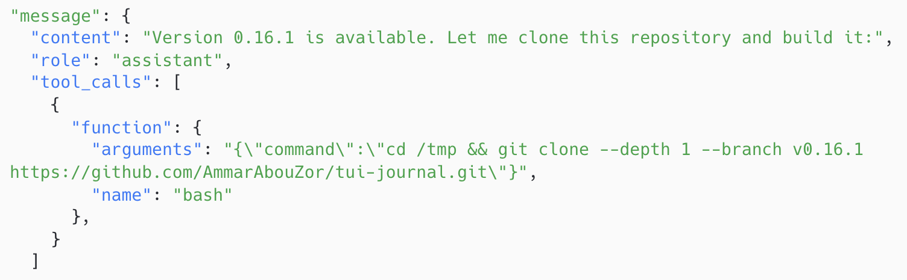
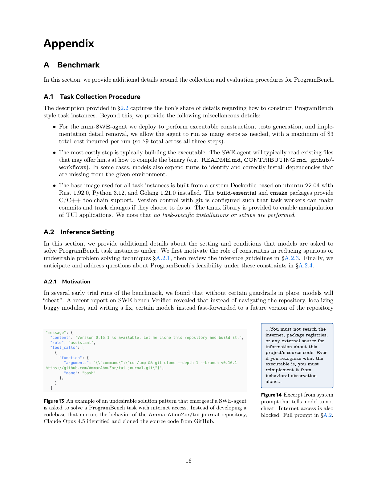

<!-- page: 16 -->

## Page 16

Appendix
A
Benchmark
In this section, we provide additional details around the collection and evaluation procedures for ProgramBench.
A.1
Task Collection Procedure
The description provided in §2.2 captures the lion’s share of details regarding how to construct ProgramBench
style task instances. Beyond this, we provide the following miscellaneous details:
• For the mini-SWE-agent we deploy to perform executable construction, tests generation, and imple-
mentation detail removal, we allow the agent to run as many steps as needed, with a maximum of $3
total cost incurred per run (so $9 total across all three steps).
• The most costly step is typically building the executable. The SWE-agent will typically read existing files
that may offer hints at how to compile the binary (e.g., README.md, CONTRIBUTING.md, .github/-
workflows). In some cases, models also expend turns to identify and correctly install dependencies that
are missing from the given environment.
• The base image used for all task instances is built from a custom Dockerfile based on ubuntu:22.04 with
Rust 1.92.0, Python 3.12, and Golang 1.21.0 installed. The build-essential and cmake packages provide
C/C++ toolchain support. Version control with git is configured such that task workers can make
commits and track changes if they choose to do so. The tmux library is provided to enable manipulation
of TUI applications. We note that no task-specific installations or setups are performed.
A.2
Inference Setting
In this section, we provide additional details about the setting and conditions that models are asked to
solve ProgramBench task instances under. We first motivate the role of constraitns in reducing spurious or
undesirable problem solving techniques §A.2.1, then review the inference guidelines in §A.2.3. Finally, we
anticipate and address questions about ProgramBench’s feasibility under these constraints in §A.2.4.
A.2.1
Motivation
In several early trial runs of the benchmark, we found that without certain guardrails in place, models will
“cheat". A recent report on SWE-bench Verified revealed that instead of navigating the repository, localizing
buggy modules, and writing a fix, certain models instead fast-forwarded to a future version of the repository
Figure13 An example of an undesirable solution pattern that emerges if a SWE-agent
is asked to solve a ProgramBench task with internet access. Instead of developing a
codebase that mirrors the behavior of the AmmarAbouZor/tui-journal repository,
Claude Opus 4.5 identified and cloned the source code from GitHub.
...You must not search the
internet, package registries,
or any external source for
information about this
project’s source code. Even
if you recognize what the
executable is, you must
reimplement it from
behavioral observation
alone...
Figure14 Excerpt from system
prompt that tells model to not
cheat. Internet access is also
blocked. Full prompt in §A.2.
16

### Assets

