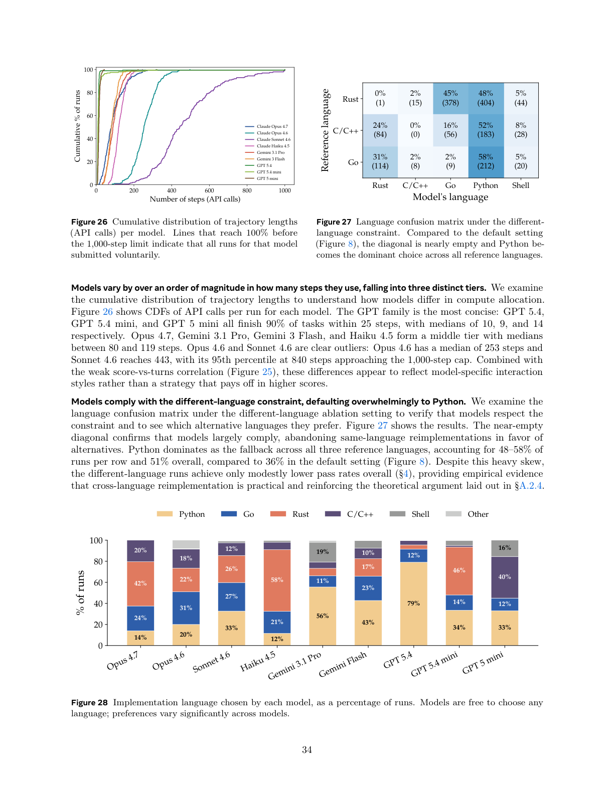

<!-- page: 34 -->

## Page 34

0
200
400
600
800
1000
Number of steps (API calls)
0
20
40
60
80
100
Cumulative % of runs
Claude Opus 4.7
Claude Opus 4.6
Claude Sonnet 4.6
Claude Haiku 4.5
Gemini 3.1 Pro
Gemini 3 Flash
GPT 5.4
GPT 5.4 mini
GPT 5 mini
Figure 26 Cumulative distribution of trajectory lengths
(API calls) per model.
Lines that reach 100% before
the 1,000-step limit indicate that all runs for that model
submitted voluntarily.
Rust
C/C++
Go
Python
Shell
Model's language
Rust
C/C++
Go
Reference language
0%
(1)
2%
(15)
45%
(378)
48%
(404)
5%
(44)
24%
(84)
0%
(0)
16%
(56)
52%
(183)
8%
(28)
31%
(114)
2%
(8)
2%
(9)
58%
(212)
5%
(20)
Figure 27 Language confusion matrix under the different-
language constraint. Compared to the default setting
(Figure 8), the diagonal is nearly empty and Python be-
comes the dominant choice across all reference languages.
Models vary by over an order of magnitude in how many steps they use, falling into three distinct tiers. We examine
the cumulative distribution of trajectory lengths to understand how models differ in compute allocation.
Figure 26 shows CDFs of API calls per run for each model. The GPT family is the most concise: GPT 5.4,
GPT 5.4 mini, and GPT 5 mini all finish 90% of tasks within 25 steps, with medians of 10, 9, and 14
respectively. Opus 4.7, Gemini 3.1 Pro, Gemini 3 Flash, and Haiku 4.5 form a middle tier with medians
between 80 and 119 steps. Opus 4.6 and Sonnet 4.6 are clear outliers: Opus 4.6 has a median of 253 steps and
Sonnet 4.6 reaches 443, with its 95th percentile at 840 steps approaching the 1,000-step cap. Combined with
the weak score-vs-turns correlation (Figure 25), these differences appear to reflect model-specific interaction
styles rather than a strategy that pays off in higher scores.
Models comply with the different-language constraint, defaulting overwhelmingly to Python. We examine the
language confusion matrix under the different-language ablation setting to verify that models respect the
constraint and to see which alternative languages they prefer. Figure 27 shows the results. The near-empty
diagonal confirms that models largely comply, abandoning same-language reimplementations in favor of
alternatives. Python dominates as the fallback across all three reference languages, accounting for 48–58% of
runs per row and 51% overall, compared to 36% in the default setting (Figure 8). Despite this heavy skew,
the different-language runs achieve only modestly lower pass rates overall (§4), providing empirical evidence
that cross-language reimplementation is practical and reinforcing the theoretical argument laid out in §A.2.4.
Opus 4.7
Opus 4.6
Sonnet 4.6
Haiku 4.5
Gemini 3.1 Pro
Gemini Flash
GPT 5.4
GPT 5.4 mini
GPT 5 mini
0
20
40
60
80
100
% of runs
14%
20%
33%
12%
56%
43%
79%
34%
33%
24%
31%
27%
21%
11%
23%
12%
14%
12%
42%
22%
26%
58%
17%
46%
20%
18%
12%
10%
40%
19%
16%
Python
Go
Rust
C/C++
Shell
Other
Figure 28 Implementation language chosen by each model, as a percentage of runs. Models are free to choose any
language; preferences vary significantly across models.
34

### Assets

Caption: Figure 26 Cumulative distribution of trajectory lengths

